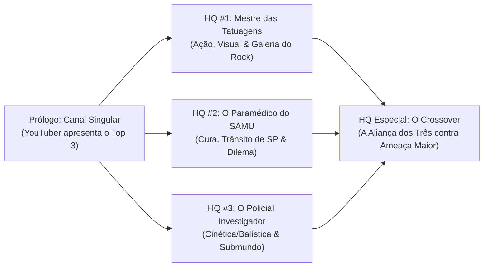

# 🎬 03. Planejamento de Roteiros e HQs (Sala de Roteiro)

Este documento guarda as diretrizes narrativas do universo compartilhado de **Histórias em Quadrinhos do LiraHQ**, o planejamento dos arcos, o catálogo de personagens e os roteiros das edições.

---

## 🧭 Tom e Diretrizes Editoriais (A Bíblia de Tom)
- **Gênero:** Ficção Urbana, Super-Heróis, Ação & Aventura com pitadas de Comédia Orgânica.
- **Classificação:** PG-13 (Ação estilizada, impacto físico, perigo real, sem gore ou sadismo).
- **Foco Temático:** Histórias universais focadas em heroísmo, criatividade no uso da ciência/física dos poderes, dilemas pessoais e diversão. Sem partidarismo, polarização ou pautas ideológicas divisivas.

---

## 🗺️ Estrutura Editorial: Fase 1 — A Trilogia das Origens

Seguindo o modelo de universos compartilhados consagrados (como a Fase 1 dos quadrinhos), cada herói ganha sua edição solo de apresentação antes do grande evento coletivo:

---

## 📺 O Dispositivo Narrativo de Abertura: "Canal Singular"

A **HQ #1** abre com um formato moderno, dinâmico e cômico: a tela de um canal de vídeos online (estilo YouTube/TikTok).

- **O Apresentador:** Um criador de conteúdo carismático, acelerado e sensacionalista que acompanha tudo sobre os Despertos em São Paulo.
- **Função Narrativa:** Em apenas 3 páginas, situa o leitor no universo, mostra a reação do público aos poderes e apresenta o **Top 3 Despertos Mais Misteriosos da Cidade**:
  1. **Top 3 — O Policial Inviolável:** Vídeo vazado de câmera de viatura mostrando disparos à queima-roupa desviando misteriosamente da trajetória de um policial (Herói da HQ #3).
  2. **Top 2 — O Milagre da Ambulância:** Fotos de celular de acidentes na Marginal Tietê onde feridos graves se recuperam de forma inexplicável antes da chegada das equipes de resgate (Herói da HQ #2).
  3. **Top 1 — A Fera de Nanquim:** Imagens de segurança tremidas de um jovem no Centro de SP fazendo um tigre saltar da própria pele para conter uma gangue (Herói da HQ #1).
- **A Transição:** O YouTuber encerra o vídeo dando o foco total no Top 1: *"E é a história desse cara que nós vamos acompanhar agora!"* ➔ Corte cinematográfico para a rotina real do protagonista.

---

## 🦸‍♂️ Catálogo dos Três Protagonistas da Fase 1

### 1. 🐅 O Mestre do Nanquim (Protagonista da HQ #1)
* **Domínio:** Transmutação (Especialidade: Transmutação de Pigmentos e Carbono).
* **Mecânica do Poder:** A tinta mineral em sua pele se desprende dos poros quando energizada com Singularidade, ganhando massa tridimensional e vida própria. A pele fica limpa/em branco enquanto os construtos (tigre, carpas, correntes) estão no mundo físico.
* **Cenário & Estilo:** Urbano, Centro de São Paulo, Praça Roosevelt e Galeria do Rock (onde precisa ir para "reabastecer o arsenal" com novas tatuagens).
* **Tom:** Aventura vibrante, comédia de situação e impacto visual com páginas duplas épicas.

### 2. 🚑 O Paramédico do SAMU (Protagonista da HQ #2)
* **Domínio:** Biogênese (Especialidade: Aceleração Celular e Regeneração de Tecidos).
* **Mecânica do Poder:** Cura ferimentos graves e estabiliza traumas biológicos ao toque. Seu grande desafio é esconder o poder para não virar cobaia de corporações farmacêuticas ou do governo.
* **Cenário & Estilo:** Ambulância cortando o trânsito da Marginal Tietê e Av. Paulista, plantões exaustivos de 24h, dinâmica divertida com o parceiro motorista veterano.
* **Tom:** Tensão contra o relógio, heroísmo altruísta e empatia com toques de alívio cômico no cotidiano hospitalar.

### 3. 🛡️ O Policial Tático (Protagonista da HQ #3)
* **Domínio:** Cinética & Forças (Especialidade: Deflexão Vetorial e Manipulação Balística).
* **Mecânica do Poder:** Altera a trajetória de objetos em alta velocidade ao redor do seu corpo (fazendo projéteis e estilhaços errarem o alvo).
* **Cenário & Estilo:** Investigação policial, corredores do submundo paulistano, galpões industriais e operações noturnas contra facções criminosas com armas sintéticas.
* **Tom:** Suspense policial clássico, adrenalina, raciocínio tático e ação no estilo "street-level".

---

## 📖 Planejamento da HQ #1: A Fera de Nanquim

* **Ato 1 (Começo):** 
  * Abertura com o YouTuber do *Canal Singular* apresentando o Top 3.
  * Transição para o protagonista na Galeria do Rock retocando suas artes e tentando pagar o aluguel.
  * Incidente Incitante: Um confronto inesperado força a revelação do seu poder em plena luz do dia.
* **Ato 2 (Meio):**
  * O protagonista vira alvo de uma organização/vilão que busca sintetizar ou roubar seu método de transmutação de pigmentos.
  * Teste das limitações do poder (tatuagens pequenas saindo erradas, tinta se desgastando, dor física).
  * Descoberta dos reais planos do antagonista para o Centro de SP.
* **Ato 3 (Clímax):**
  * Confronto decisivo em um ponto icônico de São Paulo.
  * Uso criativo e engenhoso das regras físicas da tinta para derrotar o vilão.
  * Conclusão comemorativa e gancho que deixa a pulga atrás da orelha para a HQ #2.
